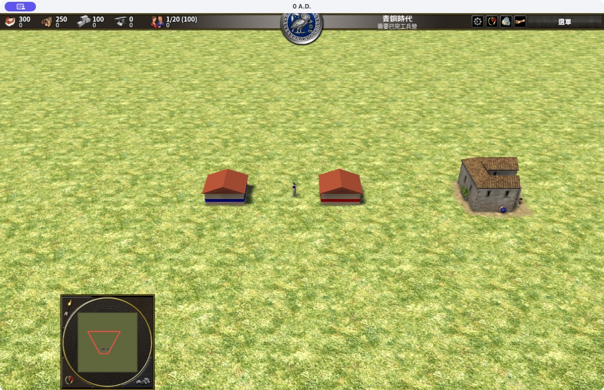
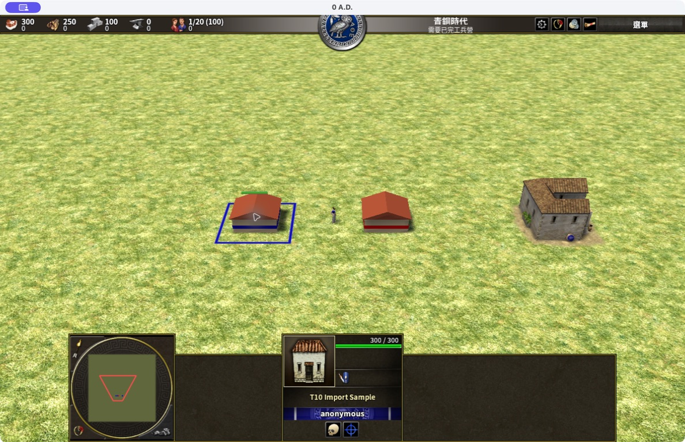
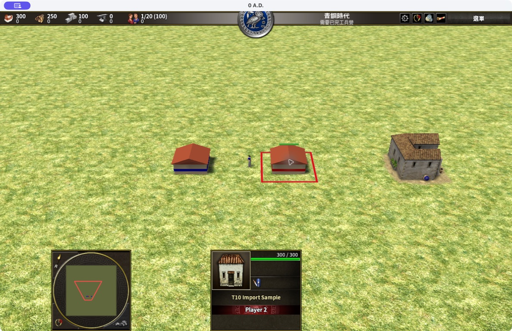

<!-- Purpose: T10 actual native import evidence and limits. Created: 2026-09-21. -->
# T10 靜態房屋匯入驗收

**DONE：僅限暫用靜態房屋與可重現匯入樣板。** [A10-01～06](../t10-asset-import.md)均有下列證據；T11原創美術垂直切片仍TODO。沒有修改C++或M2既有資產。

環境：官方R28 0.28.0 macOS ARM64、macOS26.6.2、epoch_rts 0.3.0；起點master `6221d74`。Python3.9.6標準庫匯出，未使用Blender。實際binary／public.zip與T08基線雜湊一致，見[runtime與原生cache紀錄](t10-runtime-assets.json)。

| 驗證 | 實際結果 | 證據 |
| --- | --- | --- |
| 可編輯來源與匯出 | JSON→COLLADA1.4.1／PNG；重新產生位元一致；4項參數、幾何、尺寸與確定性測試PASS | [匯入手冊](../../../assets/epoch-rts/t10-house/README.md)、[工具結果](t10-regression-results.json) |
| 引擎seed42／7 | 各13項PASS，0錯誤／0警告；結果收集後受控停止exit -15 | [引擎結果](t10-engine-results.json) |
| 各seed原始重播 | 各13項PASS、suite與來源一致；自然EOF、exit0；hash檢查數0 | 同上；只證明事件／結果一致，不是完整狀態或多人同步 |
| GUI最終場次 | 13項PASS、正常exit0、0錯誤／0警告；藍／紅玩家色、滑鼠選取與HP300可見 | [GUI紀錄](t10-visual-validation.json)、下列三張截圖 |
| M1載入回歸 | seed42 PASS，0錯誤／0警告；達1389turn後受控停止 | [回歸結果](t10-regression-results.json) |
| 來源固定 | 五場同一full Mod、runner、資產參數與exporter；T08既有75個Mod檔案未變 | [manifest](t10-source-manifest.json)、[核對](t10-runtime-assets.json) |

13項檢查涵蓋六組M2繼承規則（Cost、Health、Footprint、Obstruction、Population、BuildRestrictions）、新actor、HP300、落地高度、雙玩家ownership、工人抵達／繞路及房屋HP保持。工人從(290,300)走到(338,300)，100個200ms位置樣本，最大z偏移約7.8625；這是單房屋通行探針，不是大規模尋路或所有方向的證明。

新增DAE／PNG由原生引擎產生PMD／DDS cache，並在實際視窗顯示。cache清單包含調整前後版本，不把每個cache檔名推論為最終資產的一對一映射；最終來源以manifest、最終場次與GUI為準。原始stdout／HTML日誌與重播保留在被忽略的`work/epoch-rts-t10/<run_id>/`；公開JSON記錄run_id及日誌雜湊，未提交本機cache。

## 修正與限制

初版玩家色帶位於屋簷下不易辨識，改為四面下牆色帶並重跑GUI。審查發現極小尺寸仍使用固定門高，修正為依尺寸比例縮放、拒絕bool尺寸及過大屋簷；新增小尺寸測試，最終來源再完成五場驗證。唯讀程式複查無阻擋項。

- 80三角形、162頂點、64×16RGBA色塊貼圖；是暫用簡模，沒有正式材質、LOD、骨架或動畫。
- 可視量體11×6×9公尺；保留M2的16×16 footprint與14×14 obstruction，外圈空白是已知差異，沒有聲稱精確視覺碰撞。
- 只測預放房屋。建造中模型、損壞／倒塌、正式圖示、其他光照／地形及跨平台未驗收；HUD圖示仍沿用上游。
- Blender匯出、人物動畫、效能門檻、存讀檔與多人均NOT RUN。三棟建築場景不能推導資產效能預算。
- T05–T08未重做；T07精確彈道／停機位與T08攻擊gate限制全部保留。

下一步T11：先定義工人、戰鬥單位、建築與HUD的最小原創垂直切片及動作驗收，調查可用製作工具；本次不把靜態匯入成功當作人物製作流程完成。

截圖中的上游地形、單位、參考房屋及HUD由Wildfire Games／各素材作者提供，署名與CC BY-SA3.0見[素材登錄](../assets.md)。本次只做本機提交，未push。
