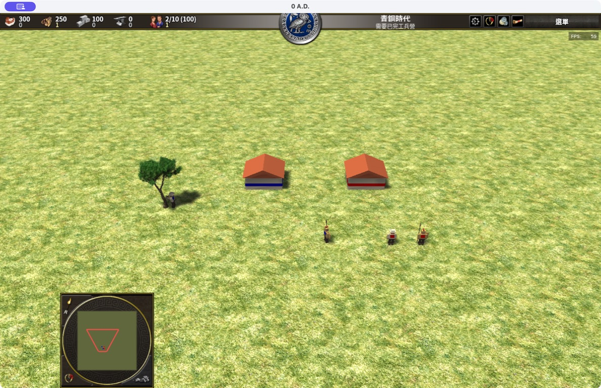
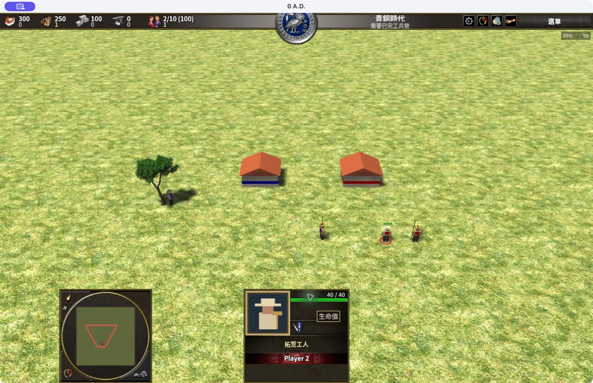
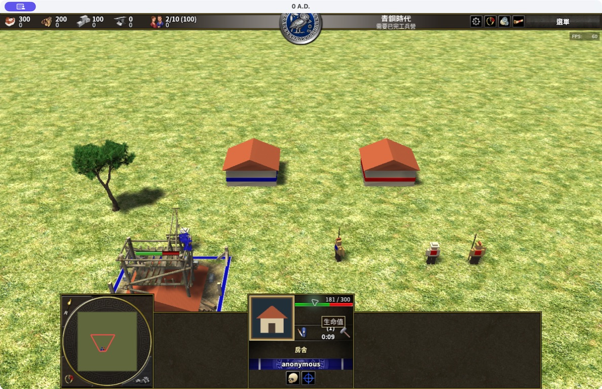
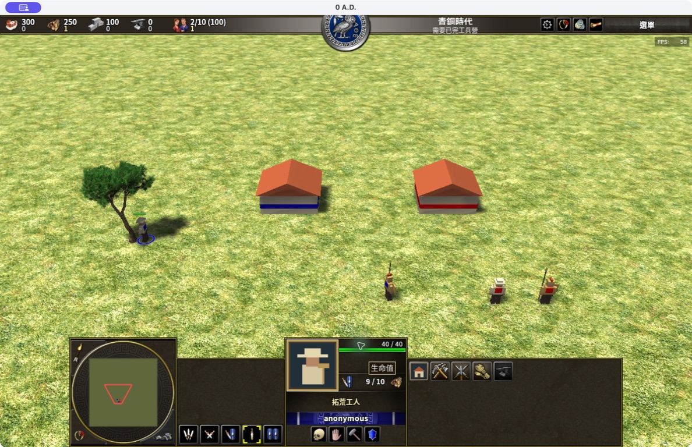
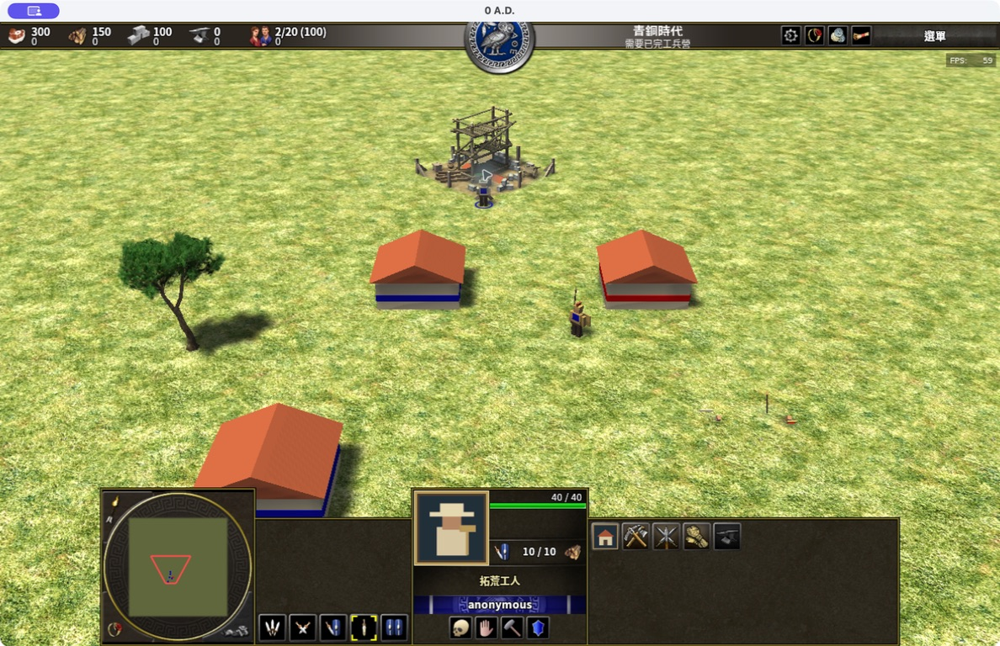
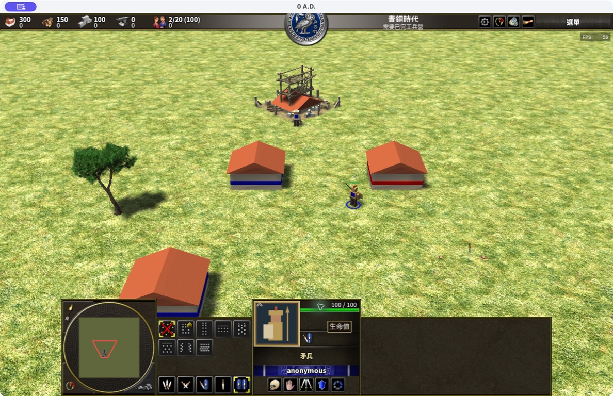
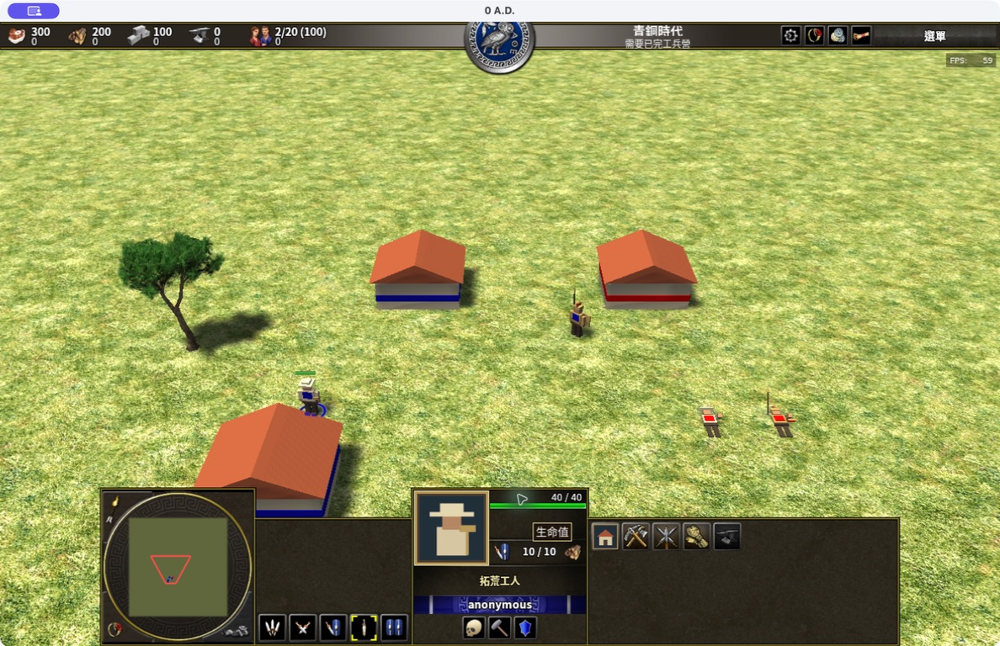
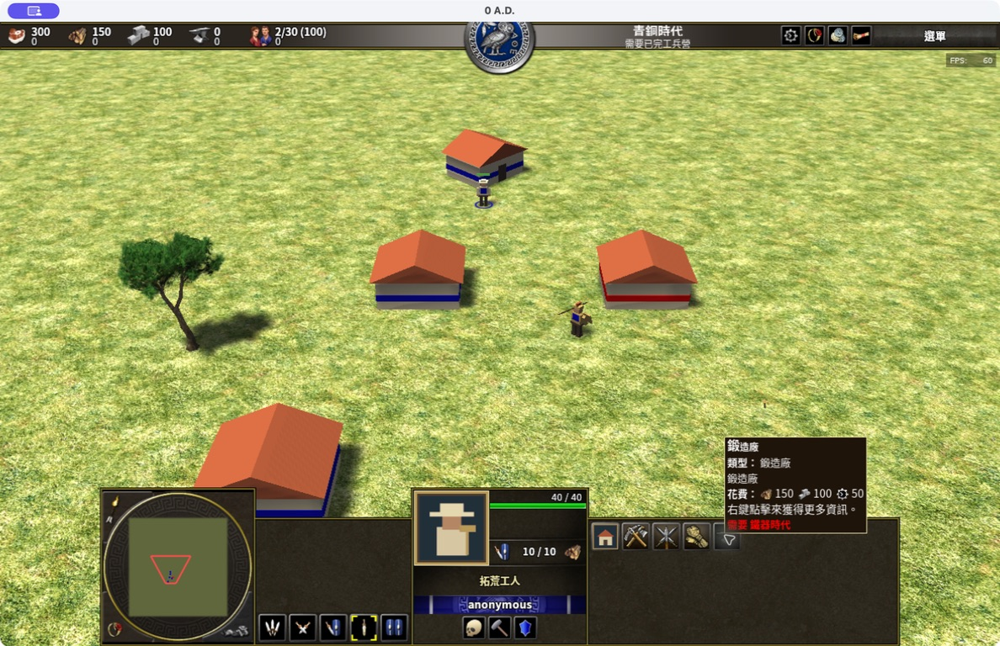
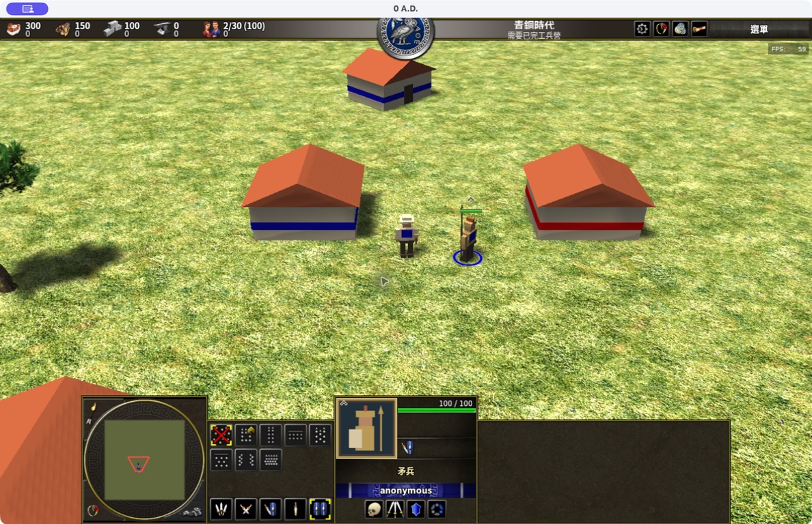
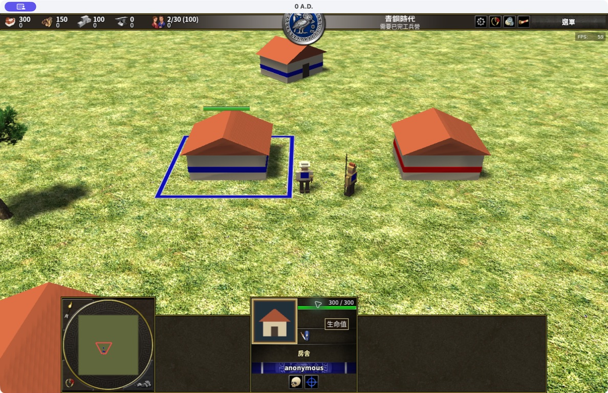

<!-- Purpose: T11 original art slice actual results and boundaries. Created: 2026-09-22. -->
# T11 原創美術切片驗收

**DONE：限定一個工人、一個長矛兵、一棟房屋與三個HUD圖示的低面數原創樣板。** [驗收契約](../t11-art-slice.md) A11-01～06於此範圍通過；不代表全部美術、完整人體rig或發行品質完成。M2原檔及T05–T10限定證據未更動；T16–T18仍TODO。

起點master `9d36013`、乾淨工作樹；2026-09-21～22於官方R28 0.28.0、macOS26.6.2 ARM64、Apple M4／16GB驗收。實際binary與public.zip SHA-256同T10，82個既有Mod檔逐檔未變。沒有修改C++／public、安裝套件、使用付費服務或push。

| 驗收 | 結果與證據 |
| --- | --- |
| A11-01 工人 | 原創mesh、寬帽、玩家色、idle／walk／採木／Build（修理及施工）／death已原生匯入並顯示；採木200→190、修理220→300、施工完成 |
| A11-02 長矛兵 | 原創盔／盾／矛、胸部玩家色、共用7骨rig；idle／walk／近戰／death顯示；紅房HP300→229.1412；兩幀揮矛角度不同 |
| A11-03 房屋 | T10 exporter重用、T11獨立輸出；新房50木／25秒、人口+10；正常施工預覽＋鷹架＋完工，未改原M2房屋 |
| A11-04 HUD | 三個128×128原創圖示；工人建造清單指向新房屋，實際點按可施工；選取、HP、人口、資源、時代及繼承的未解鎖提示可讀 |
| A11-05 引擎／重播 | seed42／7各126項PASS，兩原始重播126項及suite／來源一致、正常EOF exit0；兩個最終来源GUI場次exit0、0錯誤／警告 |
| A11-06 重現／場景觀察 | export --check及5項工具測試PASS；mesh／PSA／DDS、來源雜湊與原始檔齊備；M4／16GB小場景FPS截圖57–60，只是觀察，不是T14效能驗收 |

[引擎結果](t11-engine-results.json) · [來源manifest](t11-source-manifest.json) · [runtime／原生cache](t11-runtime-assets.json) · [GUI紀錄](t11-visual-validation.json) · [工具與回歸](t11-regression-results.json) · [製作與匯入手冊](../../../assets/epoch-rts/t11-slice/README.md)

126項主要是繼承的玩法／Identity欄位核對，不是126種動作測試。Builder唯一例外是house→t11_house美術引用；Rate／成本／工時／資源／限制維持相同。施工中實測UnitAI.REPAIRING，完成時確認新增房屋及50木扣款。死亡用測試腳本Health.Kill觸發，未驗證各武器致死矩陣。

兩個nonvisual場次收集結果後受控停止exit -15；兩重播自然EOF exit0、hash行數0，只证明事件／結果一致。GUI runner的`visual_verified:false`表示工具不自動判定美術，實際畫面檢查另列visual-validation。09-22補驗在suite後手動點建造按鈕（200→150木，人口20→30），以及另發移動／攻擊指令取圖；這些手動操作不是原兩seed重播的內容。

## 畫面證據

最終來源場次的正常鏡頭與紅方工人、施工及建造中的原創按鈕：

09-22補驗同一來源；工人採木數量、揮矛、倒地、新房屋按鈕、不可用提示及人物近照：

畫面依工具實際視窗為1188×768像素（啟動參數1280×800），zh_TW、1×，部分圖有滾輪放大。兩棟預置房屋、4名人物、1棵樹起始；腳本再建1棟，補驗手動再建1棟。FPS未量測p95／p99、載入耗時、GPU／記憶體或大軍隊；不能據此制定正式資產效能預算。

## 修正、品質及未驗範圍

- 首輪把`@parent`中繼資料誤當玩法比較，3項誤判；修正為忽略此中繼資料並逐項核對Identity。未放寬實際玩法規則。
- 發現工人建造清單仍指向M2房屋，改為T11子模板內唯一美術引用重映射，新增施工中、完工及扣款檢查，重跑兩seed與重播。最終6場來源完全相同。
- 人物為rigid分段7骨：沒有肘／膝、手指或肩部連續變形。動作粗略、工具固定在手上、採木／施工共用work；不是自然人體動作。近照可见積木狀量體，正式美術需重製拓樸／UV與更完整rig。
- 骨架／skin／clip直接輸出COLLADA；實際R28產生7骨PMD與5個多幀PSA。Blender／Assimp未使用，不能宣稱Blender匯出或重匯入已驗證。
- 僅採木與施工／修理、單一近戰動作驗收；其他採集、run、轉向過渡、隊形、斜坡、載物專用動作、不同光照／陣營色組合、LOD與大規模效能未驗收。
- 房屋仍為簡單量體、與16×16 footprint有外圈留白；鷹架引用public，沒有原創專用施工／損壞／倒塌模型。完整HUD背景、文明徽章、研究圖示及其他建築仍暫用上游。
- 原M2內容未被全量替換，T11在隔離地圖驗收；T12 AI、T13存讀檔／多人、T14效能、T15發行工作尚未完成。T07即時防空、90m落地區、精確彈道／停機位／建築避碰限制及T08 hidden／失去偵測仍受原生攻擊的限制不變。

原始engine.log、重播、逐幀工作截图及初版失敗／中間版本證據留於被忽略的work；公開結果附run_id與雜湊，未提交cache／本機私密路徑。截圖含Wildfire Games public素材，署名及CC BY-SA3.0見[素材登錄](../assets.md)。本次本機提交版本由Git歷史追溯，未push。
